# [📈 Live Status](https://AIkry.github.io/upptime): <!--live status--> **🟧 Partial outage**

This repository contains the open-source uptime monitor and status page for [AIkry](https://AIkry.github.io/upptime), powered by [Upptime](https://github.com/upptime/upptime).

With [Upptime](https://upptime.js.org), you can get your own unlimited and free uptime monitor and status page, powered entirely by a GitHub repository. We use [Issues](https://github.com/AIkry/upptime/issues) as incident reports, [Actions](https://github.com/AIkry/upptime/actions) as uptime monitors, and [Pages](https://AIkry.github.io/upptime) for the status page.

<!--start: status pages-->
<!-- This summary is generated by Upptime (https://github.com/upptime/upptime) -->
<!-- Do not edit this manually, your changes will be overwritten -->
<!-- prettier-ignore -->
| URL | Status | History | Response Time | Uptime |
| --- | ------ | ------- | ------------- | ------ |
|  [clickhouse.pontiff.de](https://clickhouse.pontiff.de) | 🟩 Up | [clickhouse.yml](https://github.com/AIkry/upptime/commits/HEAD/history/clickhouse.yml) | 

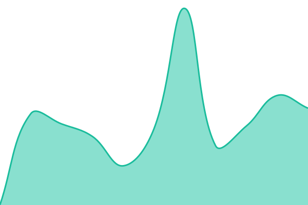 391ms
     
 | 

<a href="https://AIkry.github.io/upptime/history/clickhouse">100.00%</a>
    

|  [cloudbeaver.pontiff.de](https://cloudbeaver.pontiff.de) | 🟩 Up | [cloudbeaver.yml](https://github.com/AIkry/upptime/commits/HEAD/history/cloudbeaver.yml) | 

 319ms
     
 | 

<a href="https://AIkry.github.io/upptime/history/cloudbeaver">100.00%</a>
    

|  [syncthing-obsidian.pontiff.de](https://syncthing-obsidian.pontiff.de) | 🟩 Up | [syncthing-obsidian.yml](https://github.com/AIkry/upptime/commits/HEAD/history/syncthing-obsidian.yml) | 

 622ms
     
 | 

<a href="https://AIkry.github.io/upptime/history/syncthing-obsidian">100.00%</a>
    

|  [open-webui.pontiff.de](https://open-webui.pontiff.de) | 🟩 Up | [open-webui.yml](https://github.com/AIkry/upptime/commits/HEAD/history/open-webui.yml) | 

 373ms
     
 | 

<a href="https://AIkry.github.io/upptime/history/open-webui">100.00%</a>
    

|  [calibre-web.pontiff.de](https://calibre-web.pontiff.de) | 🟩 Up | [calibre-web.yml](https://github.com/AIkry/upptime/commits/HEAD/history/calibre-web.yml) | 

 503ms
     
 | 

<a href="https://AIkry.github.io/upptime/history/calibre-web">100.00%</a>
    

|  [kavita.pontiff.de](https://kavita.pontiff.de) | 🟩 Up | [kavita.yml](https://github.com/AIkry/upptime/commits/HEAD/history/kavita.yml) | 

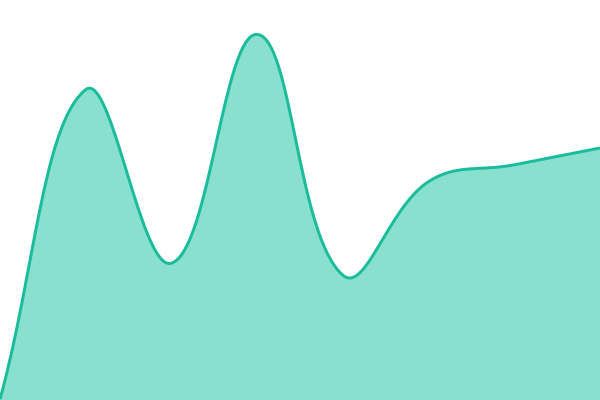 429ms
     
 | 

<a href="https://AIkry.github.io/upptime/history/kavita">100.00%</a>
    

|  [qbit-oracle.pontiff.de](https://qbit-oracle.pontiff.de) | 🟩 Up | [qbit-oracle.yml](https://github.com/AIkry/upptime/commits/HEAD/history/qbit-oracle.yml) | 

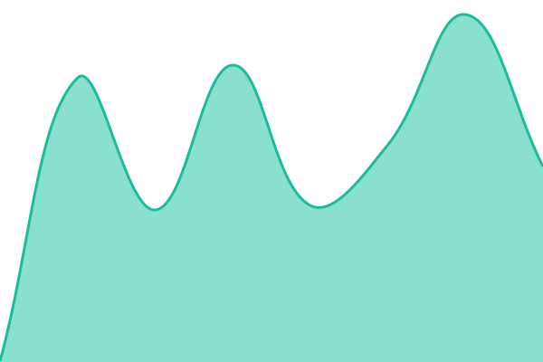 325ms
     
 | 

<a href="https://AIkry.github.io/upptime/history/qbit-oracle">100.00%</a>
    

|  [thelounge.pontiff.de](https://thelounge.pontiff.de) | 🟩 Up | [thelounge.yml](https://github.com/AIkry/upptime/commits/HEAD/history/thelounge.yml) | 

 642ms
     
 | 

<a href="https://AIkry.github.io/upptime/history/thelounge">100.00%</a>
    

|  [paperless-ai.pontiff.de](https://paperless-ai.pontiff.de) | 🟩 Up | [paperless-ai.yml](https://github.com/AIkry/upptime/commits/HEAD/history/paperless-ai.yml) | 

 577ms
     
 | 

<a href="https://AIkry.github.io/upptime/history/paperless-ai">100.00%</a>
    

|  [stirling-pdf.pontiff.de](https://stirling-pdf.pontiff.de) | 🟩 Up | [stirling-pdf.yml](https://github.com/AIkry/upptime/commits/HEAD/history/stirling-pdf.yml) | 

 343ms
     
 | 

<a href="https://AIkry.github.io/upptime/history/stirling-pdf">100.00%</a>
    

|  [syncthing-oracle.pontiff.de](https://syncthing-oracle.pontiff.de) | 🟩 Up | [syncthing-oracle.yml](https://github.com/AIkry/upptime/commits/HEAD/history/syncthing-oracle.yml) | 

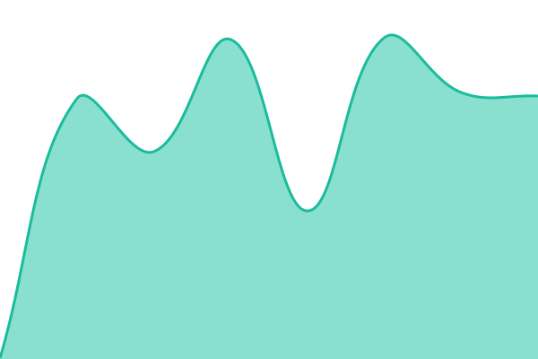 351ms
     
 | 

<a href="https://AIkry.github.io/upptime/history/syncthing-oracle">100.00%</a>
    

|  [calibre.pontiff.de](https://calibre.pontiff.de) | 🟩 Up | [calibre.yml](https://github.com/AIkry/upptime/commits/HEAD/history/calibre.yml) | 

 314ms
     
 | 

<a href="https://AIkry.github.io/upptime/history/calibre">100.00%</a>
    

|  [searxng.pontiff.de](https://searxng.pontiff.de) | 🟩 Up | [searxng.yml](https://github.com/AIkry/upptime/commits/HEAD/history/searxng.yml) | 

 341ms
     
 | 

<a href="https://AIkry.github.io/upptime/history/searxng">100.00%</a>
    

|  [chromium.pontiff.de](https://chromium.pontiff.de) | 🟩 Up | [chromium.yml](https://github.com/AIkry/upptime/commits/HEAD/history/chromium.yml) | 

 357ms
     
 | 

<a href="https://AIkry.github.io/upptime/history/chromium">100.00%</a>
    

|  [navidrome.pontiff.de](https://navidrome.pontiff.de) | 🟩 Up | [navidrome.yml](https://github.com/AIkry/upptime/commits/HEAD/history/navidrome.yml) | 

 502ms
     
 | 

<a href="https://AIkry.github.io/upptime/history/navidrome">100.00%</a>
    

|  [flaresolverr.pontiff.de](https://flaresolverr.pontiff.de) | 🟩 Up | [flaresolverr.yml](https://github.com/AIkry/upptime/commits/HEAD/history/flaresolverr.yml) | 

 252ms
     
 | 

<a href="https://AIkry.github.io/upptime/history/flaresolverr">100.00%</a>
    

|  [syncthing.pontiff.de](https://syncthing.pontiff.de) | 🟩 Up | [syncthing.yml](https://github.com/AIkry/upptime/commits/HEAD/history/syncthing.yml) | 

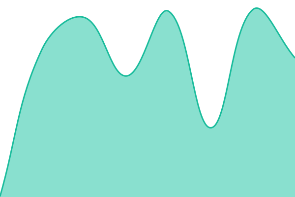 370ms
     
 | 

<a href="https://AIkry.github.io/upptime/history/syncthing">100.00%</a>
    

|  [ntfy.pontiff.de](https://ntfy.pontiff.de) | 🟩 Up | [ntfy.yml](https://github.com/AIkry/upptime/commits/HEAD/history/ntfy.yml) | 

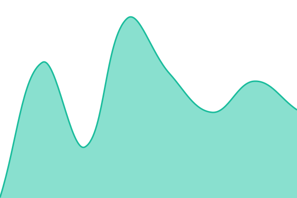 242ms
     
 | 

<a href="https://AIkry.github.io/upptime/history/ntfy">100.00%</a>
    

|  [n8n.pontiff.de](https://n8n.pontiff.de) | 🟩 Up | [n8n.yml](https://github.com/AIkry/upptime/commits/HEAD/history/n8n.yml) | 

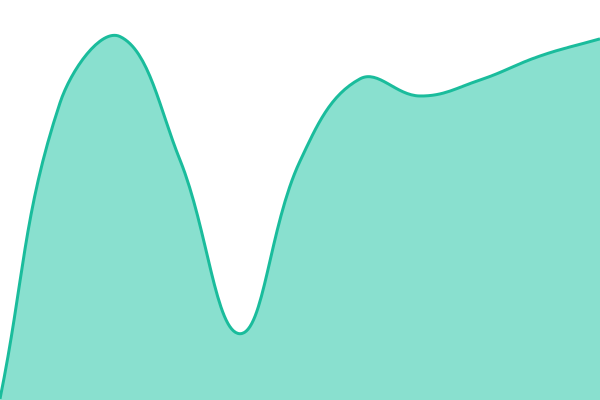 243ms
     
 | 

<a href="https://AIkry.github.io/upptime/history/n8n">100.00%</a>
    

|  [qbittorrent.pontiff.de](https://qbittorrent.pontiff.de) | 🟩 Up | [qbittorrent.yml](https://github.com/AIkry/upptime/commits/HEAD/history/qbittorrent.yml) | 

 232ms
     
 | 

<a href="https://AIkry.github.io/upptime/history/qbittorrent">100.00%</a>
    

|  [filebrowser.pontiff.de](https://filebrowser.pontiff.de) | 🟩 Up | [filebrowser.yml](https://github.com/AIkry/upptime/commits/HEAD/history/filebrowser.yml) | 

 280ms
     
 | 

<a href="https://AIkry.github.io/upptime/history/filebrowser">100.00%</a>
    

|  [paperless.pontiff.de](https://paperless.pontiff.de) | 🟩 Up | [paperless.yml](https://github.com/AIkry/upptime/commits/HEAD/history/paperless.yml) | 

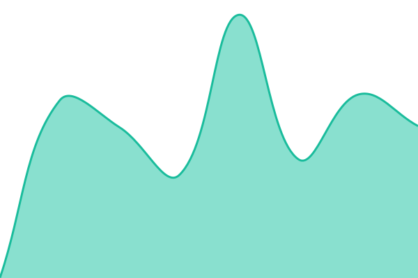 538ms
     
 | 

<a href="https://AIkry.github.io/upptime/history/paperless">100.00%</a>
    

|  [karakeep.pontiff.de](https://karakeep.pontiff.de) | 🟩 Up | [karakeep.yml](https://github.com/AIkry/upptime/commits/HEAD/history/karakeep.yml) | 

 561ms
     
 | 

<a href="https://AIkry.github.io/upptime/history/karakeep">100.00%</a>
    

|  [miniflux.pontiff.de](https://miniflux.pontiff.de) | 🟥 Down | [miniflux.yml](https://github.com/AIkry/upptime/commits/HEAD/history/miniflux.yml) | 

 360ms
     
 | 

<a href="https://AIkry.github.io/upptime/history/miniflux">0.00%</a>
    

|  [glance.pontiff.de](https://glance.pontiff.de) | 🟥 Down | [glance.yml](https://github.com/AIkry/upptime/commits/HEAD/history/glance.yml) | 

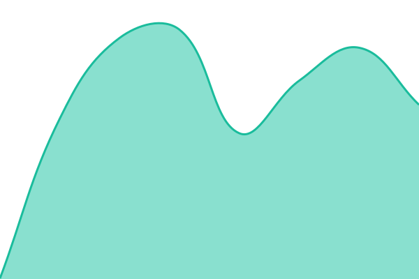 267ms
     
 | 

<a href="https://AIkry.github.io/upptime/history/glance">0.00%</a>
    

|  [portainer.pontiff.de](https://portainer.pontiff.de) | 🟩 Up | [portainer.yml](https://github.com/AIkry/upptime/commits/HEAD/history/portainer.yml) | 

 312ms
     
 | 

<a href="https://AIkry.github.io/upptime/history/portainer">100.00%</a>
    

|  [podcast.pontiff.de](https://podcast.pontiff.de) | 🟩 Up | [podcast.yml](https://github.com/AIkry/upptime/commits/HEAD/history/podcast.yml) | 

 540ms
     
 | 

<a href="https://AIkry.github.io/upptime/history/podcast">100.00%</a>
    

|  [nzbhydra2.pontiff.de](https://nzbhydra2.pontiff.de) | 🟩 Up | [nzbhydra2.yml](https://github.com/AIkry/upptime/commits/HEAD/history/nzbhydra2.yml) | 

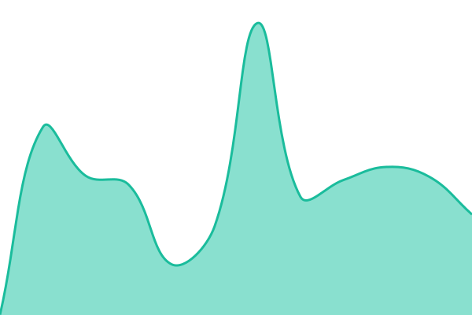 546ms
     
 | 

<a href="https://AIkry.github.io/upptime/history/nzbhydra2">100.00%</a>
    

|  [clickhouse-netcup.pontiff.de](https://clickhouse-netcup.pontiff.de) | 🟩 Up | [clickhouse-netcup.yml](https://github.com/AIkry/upptime/commits/HEAD/history/clickhouse-netcup.yml) | 

 344ms
     
 | 

<a href="https://AIkry.github.io/upptime/history/clickhouse-netcup">100.00%</a>
    

|  [historical-news.pontiff.de](https://historical-news.pontiff.de) | 🟩 Up | [historical-news.yml](https://github.com/AIkry/upptime/commits/HEAD/history/historical-news.yml) | 

 630ms
     
 | 

<a href="https://AIkry.github.io/upptime/history/historical-news">100.00%</a>
    

|  [apprise-api.pontiff.de](https://apprise-api.pontiff.de) | 🟩 Up | [apprise-api.yml](https://github.com/AIkry/upptime/commits/HEAD/history/apprise-api.yml) | 

 832ms
     
 | 

<a href="https://AIkry.github.io/upptime/history/apprise-api">100.00%</a>
    

|  [osint.pontiff.de](https://osint.pontiff.de) | 🟩 Up | [osint.yml](https://github.com/AIkry/upptime/commits/HEAD/history/osint.yml) | 

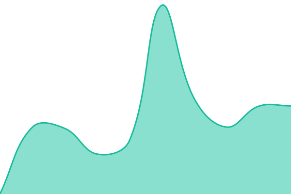 514ms
     
 | 

<a href="https://AIkry.github.io/upptime/history/osint">100.00%</a>
    

|  [wireguard.pontiff.de](https://wireguard.pontiff.de) | 🟩 Up | [wireguard.yml](https://github.com/AIkry/upptime/commits/HEAD/history/wireguard.yml) | 

 631ms
     
 | 

<a href="https://AIkry.github.io/upptime/history/wireguard">100.00%</a>
    

<!--end: status pages-->

[**Visit our status website →**](https://AIkry.github.io/upptime)

## 📄 License

- Powered by: [Upptime](https://github.com/upptime/upptime)
- Code: [MIT](./LICENSE) © [Anand Chowdhary](https://anandchowdhary.com)
- Data in the `./history` directory: [Open Database License](https://opendatacommons.org/licenses/odbl/1-0/)
